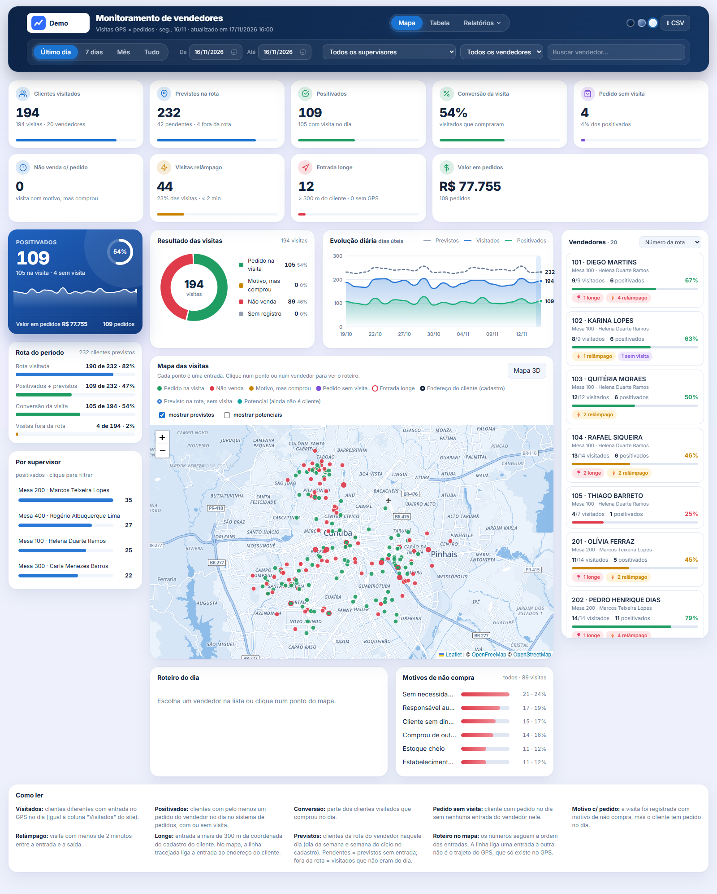

# Monitoramento de vendedores (demo)

Painel que cruza **visitas de campo** (entrada e saída no cliente, registradas por GPS) com **pedidos**, por vendedor
e por dia, para o supervisor ver quem visitou, quem vendeu e onde há sinal de visita mal feita.

> **Demonstração com dados 100% fictícios.** Vendedores, supervisores, clientes, CNPJs, rotas, visitas e pedidos são
> inventados por um gerador com semente fixa. Nada aqui vem de banco de dados ou de empresa real.



## O que o painel mostra

- **Mapa** com as entradas do dia, cores por resultado (pedido, não venda, relâmpago, entrada longe), rota prevista e
  clientes que ficaram sem visita. Também tem **mapa 3D**.
- **Cartões do dia**: clientes visitados, previstos na rota, positivados, conversão da visita, pedido sem visita,
  visitas relâmpago (menos de 2 min), entrada longe (mais de 300 m do cliente) e valor em pedidos.
- **Evolução diária**, resultado das visitas e motivos de não compra.
- **Tabela** por vendedor e dia, com exportação em CSV.
- **Relatórios**: resumo da semana e do dia com pontos de atenção, positivação da rota (com PDF), clientes sem
  justificativa e **clientes em potencial** por vendedor.
- Três temas (noite, azul e claro).

## Como ver

Abra o `index.html` no navegador (o mapa precisa de internet) ou sirva a pasta:

```bash
python -m http.server 8000
# http://localhost:8000/index.html
```

## Como gerar de novo

Só Python 3, sem dependências:

```bash
python gerar_demo.py            # últimos 31 dias
python gerar_demo.py --dias 45
```

O `gerar_demo.py` inventa o cadastro e o movimento, instala um "banco de mentira" no lugar da conexão real e passa
tudo pelo mesmo motor de cálculo (`motor/`) que o painel usa. O resultado é gravado em `index.html`.

## Estrutura

| Arquivo | Função |
|---|---|
| `gerar_demo.py` | cria os dados fictícios e gera o painel |
| `motor/gerar_painel.py` | cálculo dos indicadores por vendedor e dia |
| `motor/relatorios.py` | resumos, alertas e relatórios em PDF |
| `motor/painel_template.html` | o painel (HTML, CSS e JavaScript puros, com os dados embutidos) |
| `index.html` | painel pronto, gerado |

## Stack

Python 3, HTML/CSS/JavaScript puros, Leaflet + MapLibre (mapa) e jsPDF (PDF). Gráficos em SVG feitos à mão.
